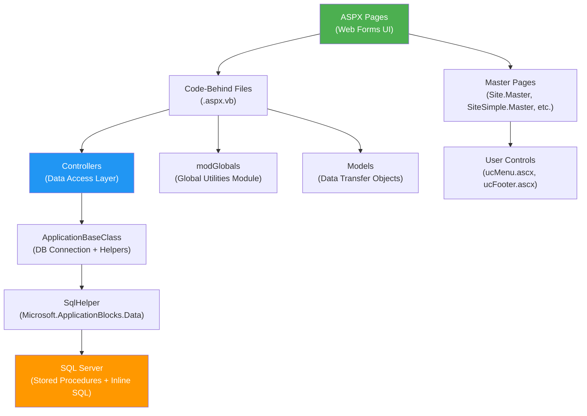
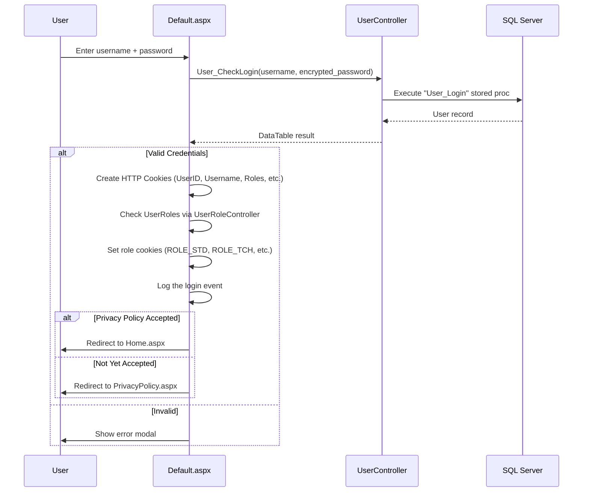

# Chula-PPS (Chula-PPEP)

## Overview

**Chula-PPS** (branded as **Chula-PPEP** — *Pharmacy Professional Experience Practice*) is a web-based management system for the **Office of Professional Experience Program, Faculty of Pharmacy, Chulalongkorn University** (หน่วยฝึกปฏิบัติงานวิชาชีพ คณะเภสัชศาสตร์ จุฬาลงกรณ์มหาวิทยาลัย).

It manages the entire lifecycle of pharmacy student field practice placements — from student registration and location assignment, through assessments and grading, to certificate generation.

---

## Technology Stack

| Layer | Technology |
|---|---|
| **Framework** | ASP.NET Web Forms (.NET Framework 4.8) |
| **Language** | VB.NET |
| **Database** | Microsoft SQL Server (via stored procedures + inline SQL) |
| **Data Access** | `Microsoft.ApplicationBlocks.Data` (`SqlHelper`) — no ORM |
| **UI Framework** | AdminLTE + Bootstrap 3.3.x |
| **UI Components** | DevExpress v17.2, AjaxControlToolkit |
| **Reports** | Microsoft ReportViewer (RDLC/SSRS) + Crystal Reports (partially commented out) + DevExpress XtraReports |
| **JavaScript** | jQuery, jQuery UI, DataTables, Select2, FullCalendar, iCheck, Bootstrap Datepicker (Thai Buddhist calendar) |
| **Encryption** | Custom `CryptographyEngine` class |
| **Hosting** | IIS (IIS Express for development) |
| **Production URL** | `http://www.chulappep.com/` |

---

## Architecture



### Key Architectural Patterns

1. **No MVC** — This is a traditional ASP.NET Web Forms project (Page → Code-behind → Controller → DB)
2. **Controller = DAL** — The "Controllers" are not MVC controllers. They are data access classes that wrap stored procedure calls
3. **Cookie-based Auth** — User session data (UserID, roles, etc.) is stored in HTTP cookies, not ASP.NET Membership
4. **`BasePage`** — A base page class that checks for a `Username` cookie and redirects to login if missing
5. **Shared `ConnectionString`** — Built dynamically from `Web.config` appSettings in `ApplicationBaseClass`

---

## Project Structure

```
Chula-PPS/
├── Controllers/              # Data Access Layer (29 files)
│   ├── ApplicationBaseClass.vb   # Base DB connection class
│   ├── modGlobals.vb             # Global utility module (1132 lines)
│   ├── UserController.vb         # User CRUD + authentication
│   ├── StudentController.vb      # Student management
│   ├── LocationController.vb     # Practice location management
│   ├── AssessmentController.vb   # Assessment engine (largest controller!)
│   ├── CourseController.vb       # Course management
│   ├── CryptographyEngine.vb     # Password encryption
│   ├── SupervisorController.vb   # Supervisor management
│   ├── PC2Controller.vb          # "Phase Choice 2" selection system
│   ├── ... (15+ more controllers)
│   └── ReportServerCredentials.vb
│
├── Models/                   # Data models (DTOs)
│   ├── PersonInfo.vb
│   ├── StudentInfo.vb
│   ├── LocationInfo.vb
│   ├── TeacherInfo.vb
│   ├── SubjectInfo.vb
│   ├── RoleInfo.vb
│   ├── PreceptorInfo.vb
│   ├── TimePhaseInfo.vb
│   └── dsStudentBio.*        # Typed DataSet for Student Bio reports
│
├── *.aspx / *.aspx.vb       # Web Forms pages (~130+ pages)
├── Site.Master               # Main master page (AdminLTE sidebar layout)
├── SiteSimple.Master         # Simplified master page
├── SiteMain.Master           # Main public-facing master page
├── SiteNoAjax.Master         # Master without AJAX ToolkitManager
│
├── ucMenu.ascx               # Main sidebar menu (Thai) — 70KB!
├── ucMenuEn.ascx             # English menu
├── ucFooter.ascx             # Footer user control
├── BasePage.vb               # Auth guard base class
│
├── Reports/                  # RDLC report files
├── css/                      # Stylesheets (AdminLTE, custom)
├── js/                       # JavaScript files
├── components/               # Frontend packages (Bootstrap, jQuery, etc.)
├── plugins/                  # iCheck and other plugins
├── images/                   # Application images
├── imgStudent/               # Student photos
├── imgPerson/                # Person photos
├── imgNews/                  # News images
├── tmpUploads/               # Uploaded documents
├── Documents/                # Document storage
│
├── Web.config                # Configuration (DB credentials, DevExpress, etc.)
├── Global.asax.vb            # Application lifecycle events
└── Chula-PPS.vbproj          # VB.NET project file
```

---

## Functional Modules

### 1. 🔐 Authentication & Users
| Pages | Purpose |
|---|---|
| `Default.aspx` | Login page + public news display |
| `Home.aspx` | Dashboard after login |
| `Users.aspx`, `UserModify.aspx` | User management |
| `UserStudent.aspx`, `UserPreceptor.aspx`, `UserAdvisor.aspx` | Role-specific user management |
| `ChangePassword.aspx`, `ChangeUsername.aspx` | Account settings |
| `ForgotPassword.aspx` | Password recovery via email |
| `Roles.aspx` | Role management |
| `PrivacyPolicy.aspx` | PDPA compliance |
| `LogfilesByUser.aspx` | Audit trail |

**User Roles:** Student (`ROLE_STD`), Teacher (`ROLE_TCH`), Advisor (`ROLE_ADV`), Preceptor (`ROLE_PCT`), Admin (`ROLE_ADM`), Super Admin (`ROLE_SPA`), Coordinator (`ROLE_CO1`)

### 2. 👨‍🎓 Student Management
| Pages | Purpose |
|---|---|
| `Student.aspx`, `StudentData.aspx` | Student list & data management |
| `Student_Reg.aspx`, `Student_Bio.aspx` | Student registration & biography |
| `StudentRegister.aspx`, `StudentNoRegister.aspx` | Registration status tracking |
| `StudentLocation.aspx`, `StudentLocation_Manage.aspx` | Student-location assignments |
| `StudentPrintBio.aspx`, `StudentPrintCert.aspx` | Print bios & certificates |
| `StudentCert.aspx` | Certificate management |
| `StudentAsmStatus.aspx` | Assessment status overview |
| `COVIDScreening.aspx`, `COVIDList.aspx` | COVID-19 screening (pandemic feature) |

### 3. 🏥 Practice Location Management
| Pages | Purpose |
|---|---|
| `Location.aspx`, `LocationDetail.aspx` | Location CRUD (largest page: 46KB!) |
| `LocationGroup.aspx`, `LocationZone.aspx` | Location grouping/zoning |
| `LocationWork.aspx`, `LocationOffice.aspx` | Work place & office details |
| `LocationList.aspx`, `LocationMaps.aspx` | Location listings & maps |

### 4. 📋 Assessment & Evaluation
| Pages | Purpose |
|---|---|
| `AssessmentStudent.aspx`, `AssessmentAdmin.aspx` | Assessment execution |
| `AssessmentResult.aspx`, `AssessmentResultPreceptor.aspx` | Result viewing |
| `AssesseeList.aspx`, `AssesseeEvaluationGroup.aspx` | Assessment assignments |
| `EvaluationForm.aspx`, `EvaluationGroup.aspx`, `EvaluationSubject.aspx`, `EvaluationTopic.aspx` | Evaluation form builder |
| `Grade.aspx`, `GradePreceptor.aspx`, `GradeResult.aspx` | Grading system |
| `AssesseeComment.aspx`, `AssessmentStudentComment.aspx` | Comment/feedback system |

### 5. 📅 Time Phase & Course Management
| Pages | Purpose |
|---|---|
| `TimePhase.aspx`, `TurnPhase.aspx` | Practice period scheduling |
| `Courses.aspx`, `CourseStudent.aspx`, `CourseLocation.aspx`, `CourseCoordinator.aspx` | Course management |
| `Subjects.aspx` | Subject management |

### 6. 🎯 Student Assignment (3 modes)
| Pages | Purpose |
|---|---|
| `AssignRandom.aspx` | Random assignment |
| `AssignManual.aspx` | Manual assignment |
| `AssignSpecify.aspx` | Specified assignment |
| `AssignBypass.aspx` | Bypass assignment |
| `PracticeAssign.aspx` | Practice assignment overview |

### 7. 📊 PC2 Module (Phase Choice Round 2)
| Pages | Purpose |
|---|---|
| `PC2_Student.aspx`, `PC2_Subject.aspx` | PC2 student/subject management |
| `PC2_Quota.aspx` | Quota management |
| `PC2_StudentSelection.aspx`, `PC2_StudentResult.aspx` | Selection & results |
| `PC2_AssignManual.aspx`, `PC2_AssignRandom.aspx` | PC2 assignment |
| `PC2_Report.aspx` | PC2 reporting |

### 8. 👨‍🏫 Supervisor & Preceptor
| Pages | Purpose |
|---|---|
| `SupervisorManage.aspx`, `SupervisorSelect.aspx` | Supervisor assignments |
| `SupervisorLocation.aspx`, `SupervisionLocation.aspx` | Supervision at locations |
| `SupervisionPlan.aspx` | Supervision planning |
| `SupervisorSend.aspx` | Send student lists to supervisors |
| `PreceptorData.aspx` | Preceptor management |
| `TeacherData.aspx`, `Teacher_Reg.aspx` | Teacher management |

### 9. 📰 News & Events
| Pages | Purpose |
|---|---|
| `News.aspx`, `NewsAll.aspx`, `News_List.aspx`, `News_Manage.aspx` | News CMS |
| `Events.aspx`, `EventModify.aspx` | Event management |

### 10. 📈 Reports
| Pages | Purpose |
|---|---|
| `ReportViewer.aspx`, `ReportServerViewer.aspx`, `ReportCRViewer.aspx` | Report viewers |
| `ReportCondition*.aspx` | Report filters (by subject, location, year, course, etc.) |
| `ReportStudentLocation.aspx`, `ReportStudentBioView.aspx` | Student reports |

### 11. ⚙️ System Configuration
| Pages | Purpose |
|---|---|
| `DataConfig.aspx`, `DataConfigLevel.aspx` | System configuration |
| `TimelineSetting.aspx`, `AlertSetting.aspx` | Timeline & alert settings |
| `PaymentConfig.aspx` | Payment configuration |
| `Department.aspx`, `Positions.aspx`, `Prefix.aspx`, `Provinces.aspx` | Master data |

---

## Data Access Pattern

All controllers inherit from `ApplicationBaseClass` which:

1. Reads DB credentials from `Web.config` appSettings (`ServerPath`, `DatabaseName`, `Username`, `Password`)
2. Builds a SQL Server connection string dynamically
3. Uses `Microsoft.ApplicationBlocks.Data.SqlHelper` for all DB operations

**Two data access styles are used:**

```vb
' Style 1: Stored Procedures (preferred)
ds = SqlHelper.ExecuteDataset(ConnectionString, "StoredProcName", param1, param2)

' Style 2: Inline SQL (legacy — SQL injection vulnerable!)
SQL = "select * from Students where Student_Code='" & id & "'"
ds = SqlHelper.ExecuteDataset(ConnectionString, CommandType.Text, SQL)
```

> [!WARNING]
> Several controllers contain **inline SQL with string concatenation**, which is vulnerable to SQL injection (e.g., `StudentController.GetStudentBio_ByID`, `UserController.GetUsers_ByUsername`, `UserController.User_GetEmail`).

---

## Authentication Flow



---

## Key Configuration (`Web.config`)

| Setting | Value | Description |
|---|---|---|
| `ServerPath` | `45.154.25.254` | SQL Server IP |
| `DatabaseName` | `chula_pps` | Database name |
| `ProjectPath` | `http://www.chulappep.com/` | Production URL |
| `PassPhase` | `CU@THEDEV` | Encryption passphrase |
| `ReportServerURL` | `http://45.154.25.254/ReportServer` | SSRS endpoint |
| `globalization` | `th-TH` | Thai locale |
| `targetFramework` | `4.8` | .NET Framework version |

---

## Notable Characteristics

1. **Massive codebase** — 130+ ASPX pages, 29 controllers, 533+ files
2. **Thai-centric** — Buddhist Era date handling (พ.ศ.), Thai month names, Thai number conversion
3. **Email notifications** — SMTP via Gmail for alerts to preceptors
4. **Multi-language support** — Thai (`ucMenu.ascx`) and English (`ucMenuEn.ascx`) menus, toggled by `LANG` cookie
5. **Legacy patterns** — Copy-paste files exist (e.g., `Users - Copy.aspx`, `Default - Copy1.aspx`)
6. **COVID-19 features** — COVID screening forms added during the pandemic
7. **DevExpress integration** — Rich UI components for grids, reports, HTML editor
8. **Version 3.0.0** — Currently at v3.0.0 (footer says v2.0.0 but login displays 3.0.0)
