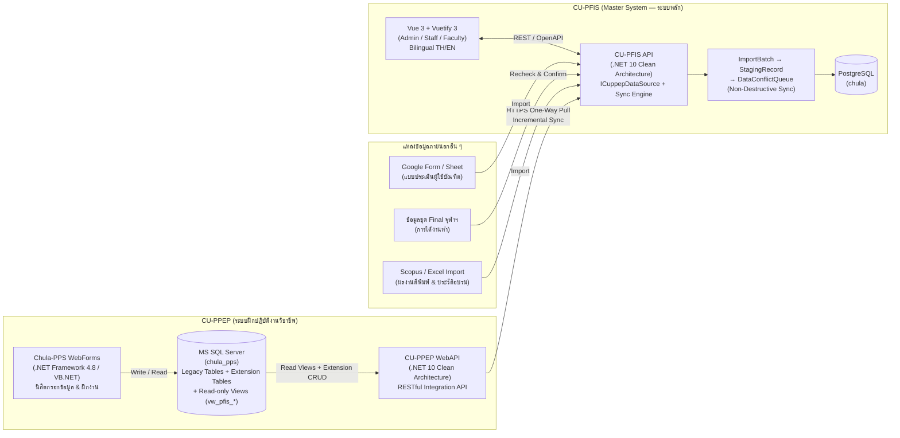

# Chula — Faculty of Pharmaceutical Sciences Monorepo

Repository กลางสำหรับรวบรวมระบบสารสนเทศของ **คณะเภสัชศาสตร์ จุฬาลงกรณ์มหาวิทยาลัย** (Faculty of Pharmaceutical Sciences, Chulalongkorn University) จำนวน **3 โปรเจ็ค** ไว้ในที่เดียวกัน เพื่อความสะดวกในการบริหารจัดการซอร์สโค้ดและการเชื่อมต่อข้อมูลระหว่างระบบ

---

## 1. ภาพรวมทั้ง 3 โปรเจ็ค (Projects Overview)

| โฟลเดอร์ | ชื่อระบบ | บทบาทและขอบเขตงาน | Tech Stack | ฐานข้อมูล |
| --- | --- | --- | --- | --- |
| [`CU-PFIS/`](CU-PFIS/) | **Chula Pharmacy Faculty Information System**<br>(ระบบสารสนเทศคณะเภสัชศาสตร์) | **ระบบหลัก (Master System)** ที่พัฒนาขึ้นใหม่ สำหรับบริหารข้อมูลอาจารย์ (CV), การอบรมและงบประมาณ, ข้อมูลนิสิต/ศิษย์เก่า, ผลงาน/รางวัล, การได้งานทำ, ผู้ใช้บัณฑิต, ผลสอบใบประกอบวิชาชีพ, โครงงานนิสิต และรายงานย้อนหลัง 10 ปี | **.NET 10** (Clean Architecture, CQRS/MediatR, EF Core) + **Vue 3 / Vuetify 3** (TH/EN) | PostgreSQL (`chula`) |
| [`CU-PPEP/`](CU-PPEP/) | **Chula Pharmacy Professional Experience Practice**<br>(ระบบฝึกปฏิบัติงานวิชาชีพเภสัชกรรม) | ประกอบด้วย 2 ส่วน:<br>1. **`Chula-PPS/`**: เว็บเดิมที่ใช้งานอยู่จริง (`chulappep.com`) สำหรับบริหารการฝึกปฏิบัติงานวิชาชีพ และเป็นหน้าให้นิสิตกรอกข้อมูลพื้นฐาน/ผลงาน/ผลสอบ/การได้งานทำรอบแรก<br>2. **`WebAPI/`**: RESTful Integration API ใหม่สำหรับเปิดข้อมูลให้ `CU-PFIS` ดึงไปใช้งานอย่างปลอดภัย | 1. **ASP.NET Web Forms** (VB.NET, .NET Framework 4.8, DevExpress)<br>2. **.NET 10** (Clean Architecture, EF Core) | MS SQL Server (`chula_pps`) |
| [`CU-BCP/`](CU-BCP/) | **Chula BCP**<br>(ระบบเว็บไซต์และฐานข้อมูลหลักสูตรเภสัชกรประจำบ้าน) | ระบบเว็บไซต์ประชาสัมพันธ์ CMS และฐานข้อมูลหลักสูตรเภสัชกรประจำบ้านเดิม *(เก็บไว้รวมใน repo นี้เพื่อการจัดการโค้ดเท่านั้น — **อยู่นอกขอบเขตงาน CU-PFIS ห้ามแก้ไขโดยไม่ได้รับคำสั่ง**)* | **ASP.NET Web Forms** (VB.NET, .NET Framework 4.5, DevExpress) | MS SQL Server |

---

## 2. โครงสร้างโฟลเดอร์ (Repository Structure)

```text
Chula/
├── README.md                          # เอกสารสรุปภาพรวมและโครงสร้าง Monorepo (ไฟล์นี้)
├── .gitignore                         # กฎ ignore กลางครอบคลุม .NET, Vue/Vite, IDE, packages, temp files
│
├── CU-PFIS/                           # [Master System] ระบบสารสนเทศคณะเภสัชศาสตร์ (พัฒนาใหม่)
│   ├── README.md                      # คู่มือรายละเอียดโปรเจ็ค CU-PFIS
│   ├── AGENTS.md                      # จุดเริ่มต้นบริบทสำหรับ AI Agent
│   ├── chula.sln                      # .NET 10 Solution
│   ├── .doc/                          # เอกสาร Requirement ต้นฉบับจากลูกค้า (req071169.pdf ฯลฯ)
│   ├── .ai/                           # บริบทสถาปัตยกรรม, Domain Glossary, Coding Rules, Roadmap (D01–D11, Q01–Q18)
│   ├── requirements/                  # สเปกฟีเจอร์ภาษาไทยแยกตาม Bounded Context
│   ├── src/
│   │   ├── Domain/                    # Entities, Enums, Value Objects, Domain Events (Dual-key: Id + ExternalId)
│   │   ├── Application/               # CQRS Commands/Queries (MediatR), Validators, Behaviours, Interfaces
│   │   ├── Infrastructure/            # ChulaDbContext (PostgreSQL), Migrations, Interceptors, External Adapters
│   │   ├── API/                       # ASP.NET Core Web API (Thin Controllers + Swagger/OpenAPI)
│   │   └── vuewebui/                  # Frontend (Vue 3 + Vuetify 3 + Pinia + vue-i18n TH/EN + CASL)
│   └── tests/
│       ├── Domain.UnitTests/          # Unit Tests สำหรับ Domain
│       └── Application.FunctionalTests/ # Functional / Integration Tests (PostgreSQL chula-test)
│
├── CU-PPEP/                           # ระบบฝึกปฏิบัติงานวิชาชีพเภสัชกรรม (Legacy + Integration API)
│   ├── README.md                      # เอกสารอธิบายสถาปัตยกรรมและโมดูลของ Chula-PPS
│   ├── Chula-PPEP.sln                 # Solution ของเว็บเดิม (Web Forms)
│   ├── Chula-PPS/                     # [Legacy Web] ASP.NET Web Forms (VB.NET / .NET Framework 4.8)
│   │   ├── Controllers/               # Data Access Layer (SqlHelper / Stored Procedures)
│   │   ├── Models/                    # DTOs และ Typed DataSets
│   │   ├── Reports/                   # รายงาน RDLC / SSRS
│   │   └── *.aspx / *.aspx.vb         # หน้าจอ Web Forms (130+ หน้า)
│   └── WebAPI/                        # [Integration API] RESTful API (.NET 10 Clean Architecture)
│       ├── README.md                  # เอกสาร Endpoint และ EF Core Migrations ของ CU-PPEP API
│       ├── CuPpepApi.sln              # .NET 10 Solution
│       ├── src/
│       │   ├── Domain/                # Legacy Read-Only Views + Extension Entities
│       │   ├── Application/           # CQRS Use Cases (MediatR) + ICuPpepDbContext
│       │   ├── Infrastructure/        # CuPpepDbContext (MS SQL Server), Legacy ModelBuilder, Migrations
│       │   └── API/                   # RESTful Endpoints + Swagger UI
│       └── tests/
│           └── Application.UnitTests/ # Unit / Integration API Tests
│
└── CU-BCP/                            # [Out of Scope / Reference Only] ระบบหลักสูตรเภสัชกรประจำบ้าน
    ├── README.md                      # ขอบเขตความสามารถของระบบ CU-BCP แบ่งตามเฟส (Phase 1–3)
    ├── ChulaBCP.sln                   # Solution (ASP.NET Web Forms)
    └── ChulaBCP/                      # ซอร์สโค้ด ASP.NET Web Forms (VB.NET / .NET Framework 4.5)
```

---

## 3. สถาปัตยกรรมการเชื่อมต่อระหว่างระบบ (Integration Architecture)

ระบบถูกออกแบบตามแนวทาง **Two-API Integration Architecture** เพื่อให้ระบบใหม่ (`CU-PFIS`) แยกขาดจากโครงสร้างฐานข้อมูลเดิมของ `CU-PPEP` อย่างปลอดภัย และป้องกันไม่ให้ข้อมูลที่เจ้าหน้าที่ตรวจสอบรับรองแล้วถูกเขียนทับโดยอัตโนมัติ



### หลักการสำคัญของการแบ่งหน้าที่และเชื่อมต่อข้อมูล
1. **การแบ่งหน้าที่ระหว่าง `CU-PPEP` กับ `CU-PFIS`:**
   - **นิสิต** ใช้งานและกรอกข้อมูลตนเอง (ข้อมูลพื้นฐาน, รอบรับเข้า, ผลงาน/รางวัล, ผลสอบใบประกอบวิชาชีพ, การได้งานทำรอบแรก) ผ่าน **`CU-PPEP`** เพื่อลดความซ้ำซ้อนและไม่ให้เกิดการเขียนข้อมูลชนกัน
   - **เจ้าหน้าที่ อาจารย์ และผู้ดูแลระบบ** ใช้งาน **`CU-PFIS`** เป็นระบบหลัก (Master System) สำหรับตรวจรับรองข้อมูล บริหารงบอบรม จัดการโครงงานนิสิต และออกรายงาน/Dashboard
2. **ความปลอดภัยต่อฐานข้อมูลเดิม (`chula_pps`):**
   - `CU-PFIS` **ไม่เชื่อมต่อตรง** เข้าไปที่ตารางของ MS SQL Server ของ `CU-PPEP` แต่ดึงข้อมูลผ่าน **`CU-PPEP/WebAPI`**
   - `CU-PPEP/WebAPI` อ่านตารางเดิมผ่าน **Read-Only Views** (`vw_pfis_*`) โดย EF Core Migrations จะไม่แก้ไขหรือลบตารางเดิม ส่วนตารางใหม่ที่เพิ่มเพื่อรองรับฟีเจอร์ส่วนขยายจะแยกเป็น Code-First tables โดยเฉพาะ
3. **Non-Destructive Sync (`ImportBatch` → `StagingRecord` → `DataConflictQueue`):**
   - ข้อมูลที่ดึงมาจาก `CU-PPEP` หรือแหล่งภายนอกจะเก็บแหล่งที่มา (`SourceSystem`, `SourceRecordId`, `ImportedAt`) เสมอ
   - หากรายการใดถูกเจ้าหน้าที่ตรวจสอบหรือแก้ไขรับรองใน `CU-PFIS` ไปแล้ว การดึงข้อมูลรอบถัดไปจะ **ไม่เขียนทับอัตโนมัติ** แต่จะส่งเข้าคิว `DataConflictQueue` ให้เจ้าหน้าที่พิจารณาตัดสินใจ
4. **ขอบเขตของ `CU-BCP`:**
   - `CU-BCP` เป็นระบบเดิมที่แยกอิสระ (หลักสูตรเภสัชกรประจำบ้าน) และไม่มีการเชื่อมต่อข้อมูลกับ `CU-PFIS` ในเฟสปัจจุบัน — **ไม่ควรแก้ไขไฟล์ในโฟลเดอร์ `CU-BCP/` เมื่อทำงานในขอบเขต `CU-PFIS` / `CU-PPEP`**

---

## 4. รายละเอียดแต่ละระบบโดยย่อ

### 4.1 `CU-PFIS` — ระบบสารสนเทศคณะเภสัชศาสตร์ (Master System)
- **โมดูลหลัก (Bounded Contexts):**
  - `ReferenceData`: ปีการศึกษา (ย้อนหลัง 10+ ปี), ภาควิชา/หน่วยงาน, สาขาวิชา, ตำแหน่งทางวิชาการ, รอบรับเข้า, แม่แบบเอกสาร
  - `Faculty`: ประวัติอาจารย์ (CV อาจารย์), วุฒิการศึกษา, ผลงานตีพิมพ์ (รองรับการนำเข้า Scopus), ส่งออก PDF
  - `Training`: การอบรม 4 ประเภท + ระบบสมุดคุมงบประมาณรายปีงบประมาณแบบ Append-only (`TrainingBudgetLedger`) รองรับการยืมโควต้าปีงบประมาณถัดไป และแยกขั้นตอน "เจ้าหน้าที่ตรวจสอบ" ออกจาก "อนุมัติหลังคณบดีลงนาม"
  - `Students`: CV นิสิต, การตรวจรับรองผลงาน/รางวัลจาก CUPPEP, การเทียบและยืนยันข้อมูลการได้งานทำกับชุด Final จุฬาฯ, ข้อมูลผู้ใช้บัณฑิตจาก Google Form/Sheet
  - `ProfessionalLicense`: ผลสอบใบประกอบวิชาชีพ (`CC1`, `CC2`, `IP1`, `IP2`, `PC1`, `PC2`) และสรุปร้อยละผู้สอบผ่านตามรุ่น
  - `SeniorProjects`: โครงงานนิสิต, จัดเก็บไฟล์ PDF ฉบับจริง, การรวมเล่ม Abstract รายปีอัตโนมัติ, แจ้งเตือนติดตามการใช้ประโยชน์ปีที่ 1–3
  - `Integration`, `Reporting`, `Security`: ระบบซิงก์ข้อมูลและจัดการความขัดแย้ง, Dashboard/รายงาน 2 ภาษา (TH/EN), สิทธิ์ระดับภาควิชา และการยืนยัน PDPA Consent ครั้งแรก
- **เอกสารอ้างอิงเพิ่มเติม:** [`CU-PFIS/README.md`](CU-PFIS/README.md), [`CU-PFIS/.ai/architecture.md`](CU-PFIS/.ai/architecture.md), [`CU-PFIS/.ai/roadmap.md`](CU-PFIS/.ai/roadmap.md), [`CU-PFIS/.ai/domain.md`](CU-PFIS/.ai/domain.md)

### 4.2 `CU-PPEP` — ระบบฝึกปฏิบัติงานวิชาชีพเภสัชกรรม
- **`Chula-PPS/` (Legacy Web Application):** ระบบ Web Forms (VB.NET / .NET Framework 4.8) จัดการการลงทะเบียนนิสิต แหล่งฝึก การจัดสรรแหล่งฝึก (PC2/Random/Manual) อาจารย์นิเทศก์ แหล่งฝึก การประเมินผล เกรด และใบรับรอง — ดูรายละเอียดที่ [`CU-PPEP/README.md`](CU-PPEP/README.md)
- **`WebAPI/` (RESTful Integration API):** โปรเจ็ค `.NET 10` Clean Architecture ที่ใช้แนวทางเดียวกับ `CU-PFIS` (CQRS/MediatR, Dual-key `Id` + `ExternalId`, Soft Delete, Audit Interceptor, Swagger) สำหรับให้บริการ API ดึงข้อมูลนิสิต/อาจารย์จาก `chula_pps` และ CRUD ข้อมูลส่วนขยาย (`student-profiles`, `student-achievements`, `student-license-results`, `student-employments`) — ดูรายละเอียดที่ [`CU-PPEP/WebAPI/README.md`](CU-PPEP/WebAPI/README.md)

### 4.3 `CU-BCP` — ระบบหลักสูตรเภสัชกรประจำบ้าน
- เว็บไซต์ประชาสัมพันธ์ (CMS), ฐานข้อมูลเภสัชกรประจำบ้าน/อาจารย์/แหล่งฝึก/คำร้อง และการจัดการเอกสารของหลักสูตร — ดูรายละเอียดขอบเขตเดิมที่ [`CU-BCP/README.md`](CU-BCP/README.md)

---

## 5. คำสั่งเริ่มต้นใช้งาน (Quick Start)

### รัน `CU-PFIS` (Backend API & Frontend)
```powershell
# Backend (.NET 10 Web API)
dotnet build CU-PFIS/chula.sln
dotnet run --project CU-PFIS/src/API
dotnet test CU-PFIS/chula.sln

# Frontend (Vue 3 + Vuetify 3)
cd CU-PFIS/src/vuewebui
npm install
npm run dev
```

### รัน `CU-PPEP/WebAPI` (Integration API)
```powershell
dotnet build CU-PPEP/WebAPI/CuPpepApi.sln
dotnet run --project CU-PPEP/WebAPI/src/API --launch-profile https
dotnet test CU-PPEP/WebAPI/CuPpepApi.sln
```

### โปรเจ็ค Legacy (`CU-PPEP/Chula-PPS` และ `CU-BCP/ChulaBCP`)
- เปิดไฟล์ Solution [`CU-PPEP/Chula-PPEP.sln`](CU-PPEP/Chula-PPEP.sln) หรือ [`CU-BCP/ChulaBCP.sln`](CU-BCP/ChulaBCP.sln) ด้วย **Visual Studio** (รองรับ .NET Framework 4.5 / 4.8 และ DevExpress v17.2) และรันผ่าน IIS Express
